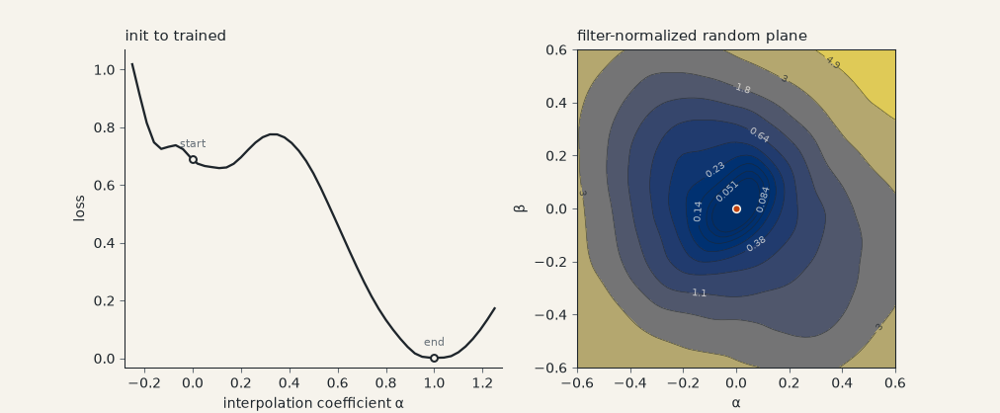

# landscape

Loss landscape plots for small PyTorch models, using the filter-normalized
random directions from Li, Xu, Taylor, Studer and Goldstein,
"Visualizing the Loss Landscape of Neural Nets" (NeurIPS 2018,
[arXiv:1712.09913](https://arxiv.org/abs/1712.09913)).

Given a model, a loss and a data loader it computes 1D slices (along a random
direction, or between two checkpoints) and 2D contour slices. Everything is
sized for models you can train on a laptop CPU.



## Use

```
pip install -e .
python examples/spirals.py    # trains a small MLP, writes outputs/spirals.png
```

```python
import landscape as ls

# model is trained; loader yields (x, y); loss_fn returns a batch mean
dx = ls.random_direction(model, seed=1)
dy = ls.random_direction(model, seed=2)

surface = ls.plane_slice(model, loss_fn, loader, dx, dy, xspan=(-0.6, 0.6), yspan=(-0.6, 0.6))
ls.plot_surface(surface).figure.savefig("plane.png")

curve = ls.between_checkpoints(model, loss_fn, loader, init_state, trained_state)
ls.plot_curve(curve).figure.savefig("path.png")
```

## Notes

- A direction has, in every filter, the norm of the matching weight filter, so
  alpha = 1 is a step of 100% of the weights' scale in each layer. Biases and
  BatchNorm parameters are not perturbed, as in the paper.
- The loader is read once and held in memory, and the model is evaluated in eval
  mode, so every grid point sees the same data and dropout is off. The model's
  weights and train/eval flags are restored afterwards.
- 2D grids are evaluated with `torch.func.vmap` in chunks; if the model or loss
  cannot be vmapped it falls back to a per-point loop with a warning.
- Between two checkpoints only parameters are interpolated. BatchNorm running
  statistics stay whatever `model` currently holds.

Needs Python 3.11+, torch, numpy and matplotlib 3.9+ (older matplotlib builds
do not import under numpy 2).

MIT licensed.
